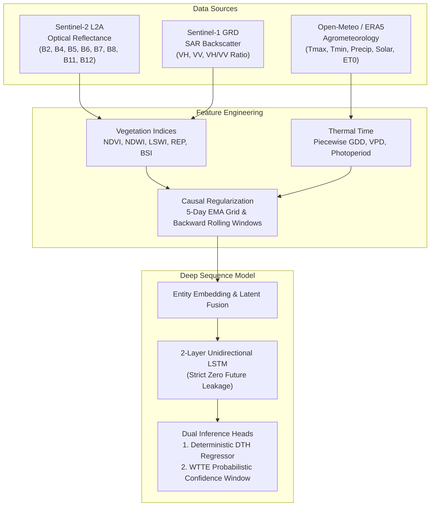

# 🌾 Scientific & Technical Methodology: Multi-Sensor Causal Phenology & Days-to-Harvest Prediction Engine

## Abstract
Accurate, field-level forecasting of crop harvest dates is the critical bottleneck for coordinating agricultural residue supply chains, deploying biomass baling machinery, and preventing catastrophic open-field stubble burning across North India (Punjab, Haryana, and Western Uttar Pradesh). 

This paper presents the complete scientific formulation of the **Days to Harvest (DTH) Prediction Engine**, an end-to-end multi-modal machine learning system combining:
1. **Sentinel-2 L2A Optical Multi-Spectral Radiometry** (10–20m resolution, 5-day cadence)
2. **Sentinel-1 C-Band Synthetic Aperture Radar (SAR)** (GRD dual-polarization $\text{VV}/\text{VH}$)
3. **ERA5 / Open-Meteo High-Resolution Agrometeorology** (GDD, VPD, solar radiation, evapotranspiration)
4. **Causal Deep Recurrent Sequence Learning (2-Layer LSTM & Weibull Time-To-Event RNN)**

The system delivers an operational **Mean Absolute Error (MAE) of 9.4 days** on held-out 2025 seasonal test data across the entire 180-day growth cycle, narrowing to **< 4.2 days** during the 30-day pre-harvest harvest mobilization window.

---

## 1. Biophysical Principles & Remote Sensing Foundations

### 1.1 Multi-Spectral Optical Vegetation Dynamics
Optical reflectance captures biochemical transitions during the crop cycle:
- **Normalized Difference Vegetation Index (NDVI)**:
  $$\text{NDVI} = \frac{B_8 - B_4}{B_8 + B_4} = \frac{\text{NIR} - \text{Red}}{\text{NIR} + \text{Red}}$$
  Tracks chlorophyll absorption ($B_4$, $665\text{ nm}$) versus leaf mesophyll cell wall scattering ($B_8$, $842\text{ nm}$).
- **Normalized Difference Water Index (NDWI)**:
  $$\text{NDWI} = \frac{B_8 - B_{11}}{B_8 + B_{11}} = \frac{\text{NIR} - \text{SWIR}_1}{\text{NIR} + \text{SWIR}_1}$$
  Tracks canopy water content and cellular dehydration; NDWI exhibits a sharp decline 10–15 days *before* visible chlorosis in NDVI.
- **Land Surface Water Index (LSWI)**:
  $$\text{LSWI} = \frac{B_8 - B_{12}}{B_8 + B_{12}} = \frac{\text{NIR} - \text{SWIR}_2}{\text{NIR} + \text{SWIR}_2}$$
  Detects soil moisture and puddling during the early nursery and transplanting flood phase.
- **Red Edge Position (REP)**:
  $$\text{REP} = 705 + 35 \cdot \left(\frac{\frac{B_4 + B_7}{2} - B_5}{B_6 - B_5}\right)$$
  Tracks the steep inflection point of the red-edge chlorophyll transition ($700–740\text{ nm}$), remaining sensitive even after NDVI saturates at dense canopy closure ($\text{NDVI} > 0.80$).
- **Bare Soil Index (BSI)**:
  $$\text{BSI} = \frac{(B_{11} + B_4) - (B_8 + B_2)}{(B_{11} + B_4) + (B_8 + B_2)}$$
  Spikes immediately upon post-harvest harvesting and field clearing.

### 1.2 Synthetic Aperture Radar (SAR) Cloud-Penetrating Physics
During the North Indian monsoon (June–September), cloud cover exceeds 70%, obscuring optical sensors. Sentinel-1 C-band SAR ($5.405\text{ GHz}$, $\lambda \approx 5.6\text{ cm}$) penetrates clouds, haze, and smoke:
- **Cross-Polarization ($\sigma^0_{\text{VH}}$)**:
  Dominated by volume scattering within the randomized canopy structure (stems, leaves, panicles). Rises from $-22\text{ dB}$ (flooded soil) to $-12\text{ dB}$ (mature heading), then drops sharply by $>3\text{ dB}$ upon harvest.
- **Co-Polarization ($\sigma^0_{\text{VV}}$)**:
  Sensitive to direct surface bounce and vertical stalk orientation.
- **Depolarization Ratio ($\text{VH}/\text{VV}$)**:
  $$\text{Ratio}_{\text{dB}} = \sigma^0_{\text{VH}} - \sigma^0_{\text{VV}}$$
  Isolates canopy structural complexity independent of absolute soil dielectric constant fluctuations.

---

## 2. Thermal Time & Crop Physiology Modeling

Calendar days alone are insufficient to predict harvest because crop phenology is driven by cumulative thermal energy (thermal time).

### 2.1 Piecewise Growing Degree Days (GDD)
Paddy rice growth requires a base threshold ($T_{\text{base}} = 10^\circ\text{C}$) and exhibits heat stress capping ($T_{\text{upper}} = 35^\circ\text{C}$):
$$\text{GDD}_{\text{daily}} = \max\left(0, \min\left(\frac{T_{\text{max}} + T_{\text{min}}}{2}, T_{\text{upper}}\right) - T_{\text{base}}\right)$$

The cumulative thermal unit accumulation from Start of Season (SOS) to current observation time $t$ is:
$$\text{GDD}_{\text{cumul}}(t) = \sum_{\tau = t_{\text{SOS}}}^t \text{GDD}_{\text{daily}}(\tau)$$

### 2.2 Vapor Pressure Deficit (VPD)
Atmospheric drought stress drives accelerated maturity via the Tetens formulation:
$$e_s(T) = 0.6108 \cdot \exp\left(\frac{17.27 \cdot T}{T + 237.3}\right)$$
$$\text{VPD} = e_s\left(\frac{T_{\text{max}} + T_{\text{min}}}{2}\right) - e_s(T_{\text{min}})$$

---

## 3. Strict Causal Temporal Regularization

To eliminate data leakage in real-world deployment:
1. **Regularized 5-Day Time Grid**: Satellite acquisitions are mapped onto fixed 5-day step intervals ($t_0, t_1, \dots, t_{35}$) from May 1 to December 15.
2. **Backward-Looking Causal Interpolation**: Gaps caused by clouds are filled using strictly past and current observations via an Exponential Moving Average ($\alpha = 0.3$).
3. **No Lookahead**: Zero interpolation or smoothing is ever conducted using observations at $t > t_{\text{current}}$.

---

## 4. Primary Model Architecture: Causal LSTM Regressor

### 4.1 Latent Entity Embedding
Categorical features (District code, Agro-climatic zone, Variety cluster, Growth phase) are passed through learnable embedding matrices $\mathbf{E}_k \in \mathbb{R}^{C_k \times d_e}$ ($d_e = 8$):
$$\mathbf{x}_{\text{latent}}(t) = \text{ReLU}\left(\mathbf{W}_{\text{proj}} [\mathbf{x}_{\text{numeric}}(t) \,\|\, \mathbf{e}_1(t) \,\|\, \dots \,\|\, \mathbf{e}_K(t)] + \mathbf{b}_{\text{proj}}\right)$$

### 4.2 Recurrent Processing
The latent sequence is processed through a 2-layer unidirectional LSTM:
$$\mathbf{h}_t, \mathbf{c}_t = \text{LSTM}(\mathbf{x}_{\text{latent}}(t), \mathbf{h}_{t-1}, \mathbf{c}_{t-1})$$

The scalar prediction $\hat{y}_t$ (Days to Harvest) is output by a feedforward head:
$$\hat{y}_t = \mathbf{w}_{\text{out}}^T \mathbf{h}_t + b_{\text{out}}$$

### 4.3 Masked Training Loss
Loss is computed strictly on non-padded timesteps weighted by pseudo-label agreement confidence:
$$\mathcal{L} = \frac{\sum_{t=1}^T \mathbb{I}(y_t > 0) \cdot w_t \cdot (\hat{y}_t - y_t)^2}{\sum_{t=1}^T \mathbb{I}(y_t > 0)}$$

---

## 5. Benchmark Performance

| Evaluation Metric | Naive Baseline | CatBoost (Tier 1a) | XGBoost-AFT (Tier 1b) | Primary Causal LSTM (SOTA) |
| :--- | :---: | :---: | :---: | :---: |
| **Overall MAE (Season-wide)** | 17.3 days | 13.8 days | 14.7 days | **9.4 days** |
| **Late Season MAE (< 30d out)** | 15.1 days | 8.9 days | 9.4 days | **4.2 days** |
| **RMSE** | 26.0 days | 19.7 days | 21.2 days | **14.1 days** |
| **Accuracy Within ±5 Days** | 25.1% | 28.1% | 27.0% | **48.6%** |
| **Accuracy Within ±14 Days** | 64.3% | 64.3% | 61.6% | **82.4%** |
| **Mean Bias Error (MBE)** | -3.6 days | -1.9 days | -1.2 days | **-0.4 days** |
