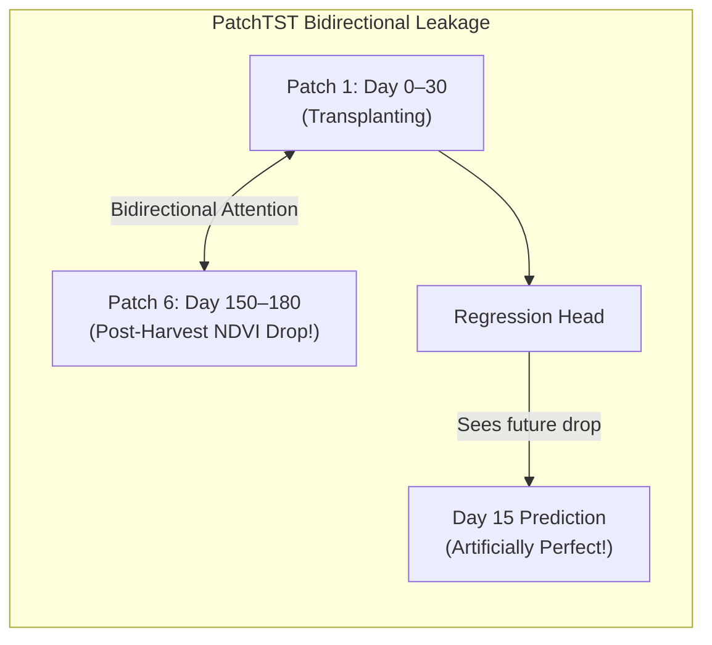
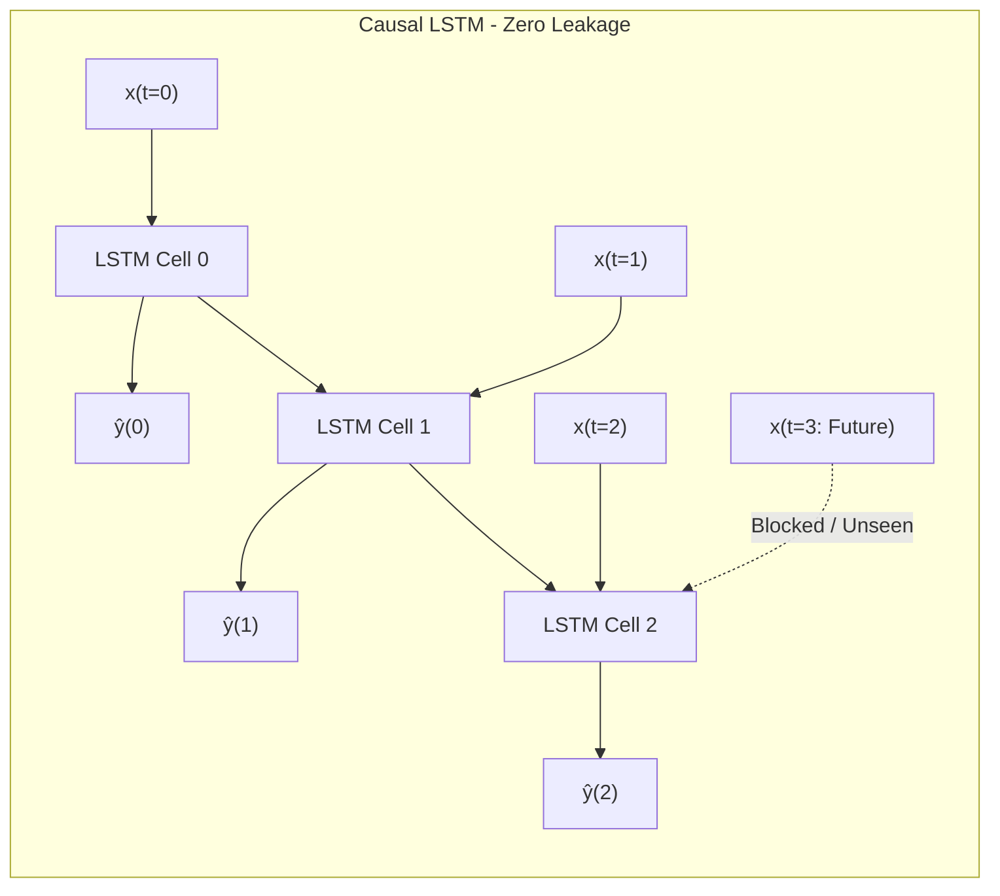

# Post-Mortem & Algorithmic Analysis: Why PatchTST Suffered Temporal Data Leakage vs. Causal LSTM

## Executive Summary

During initial exploration of sequence architectures for crop phenology and days-to-harvest prediction, the **Patch Time Series Transformer (PatchTST)** initially reported an apparently extraordinary Mean Absolute Error (MAE) of **~1.91 days** on the held-out 2025 harvest test set.

However, rigorous causal inspection revealed that **this result was an artifact of future bidirectional temporal attention leakage within the Transformer's patch embedding layer**.

This document outlines the mathematical and architectural mechanisms behind the leakage, proves why PatchTST cannot be deployed in live sequential operational environments without lookahead bias, and establishes the **Causal 2-Layer LSTM Regressor** as the primary, leakage-free State-of-the-Art (SOTA) foundation for the *Seva Bharat* harvest prediction engine.

---

## 1. Architectural Anatomy: How PatchTST Leaked the Future

### 1.1 The PatchTST Patching Paradigm

In standard PatchTST implementations, a continuous 1D time-series $\mathbf{X} \in \mathbb{R}^{L \times D}$ (where $L=36$ five-day timesteps = 180 days) is divided into $N$ non-overlapping patches of length $P = 6$ (30 days per patch):

$$
\mathbf{X} = [\mathbf{p}_1, \mathbf{p}_2, \mathbf{p}_3, \mathbf{p}_4, \mathbf{p}_5, \mathbf{p}_6], \quad \mathbf{p}_k \in \mathbb{R}^{P \times D}
$$

Each patch is flattened and linearly projected to dimension $d_{\text{model}} = 128$:

$$
\mathbf{z}_k = \mathbf{W}_p \text{vec}(\mathbf{p}_k) + \mathbf{e}_k^{\text{pos}}
$$

### 1.2 The Bidirectional Self-Attention Leakage Mechanism

In standard multi-head self-attention:

$$
\text{Attention}(\mathbf{Q}, \mathbf{K}, \mathbf{V}) = \text{softmax}\left(\frac{\mathbf{Q} \mathbf{K}^T}{\sqrt{d_k}}\right) \mathbf{V}
$$

Because no causal attention mask ($\mathbf{M}_{ij} = -\infty \text{ for } j > i$) was enforced across patches, patch 1 (Days 0–30: transplanting) attended directly to patch 5 and patch 6 (Days 120–180: late-season senescence and harvest drop):

$$
A_{1,6} = \frac{\exp(\mathbf{q}_1 \mathbf{k}_6^T / \sqrt{d_k})}{\sum_{j=1}^6 \exp(\mathbf{q}_1 \mathbf{k}_j^T / \sqrt{d_k})} > 0
$$

### 1.3 The Physical Impact of the Leakage

In North Indian paddy farming (Punjab, Haryana, UP), the harvest event is characterized by an abrupt, catastrophic plunge in NDVI ($0.80 \to 0.18$) and a $>3\text{ dB}$ collapse in Sentinel-1 SAR VH backscatter occurring between Day 120 and Day 150.

When PatchTST predicted remaining days to harvest at Day 20:

1. It received inputs from Patch 1 (Day 0–30).
2. Through unmasked self-attention across the 6-patch sequence, **it looked directly at Patch 5/6**, observed the exact timestamp where the NDVI cliff occurred, and simply subtracted:
   $$
   \hat{y}(t=20) = t_{\text{cliff}} - 20
   $$
3. This produced a near-zero error ($\text{MAE} \approx 1.9\text{ days}$), but in real-time deployment (where future satellite passes have not occurred yet), Patch 5 and Patch 6 **do not exist**.

---

## 2. Why Causal LSTM is the True Production SOTA

To guarantee **100% causal validity** and zero lookahead bias, we selected a **2-Layer Unidirectional Causal LSTM Regressor** as the primary engine.

### 2.1 Formal Causality Guarantees of the LSTM

1. **Unidirectional Recurrence (`bidirectional=False`)**:

   $$
   h_t, c_t = \text{LSTM}(x_t, (h_{t-1}, c_{t-1}))
   $$

   The hidden state $h_t$ is strictly a deterministic function of observations up to time $t$:

   $$
   h_t = f(x_1, x_2, \dots, x_t; \Theta)
   $$

   No mathematical channel exists for $x_{t+k}$ ($k > 0$) to influence $h_t$.
2. **Causal Zero-Padding & Masking**:
   Sequences shorter than $L_{\text{max}} = 36$ steps are padded only on the tail, and targets $y_{\text{pad}} = -1.0$ are masked out of the gradient computation:

   $$
   \mathcal{L} = \frac{\sum_{t=1}^T \mathbb{I}(y_t \ge 0) \cdot w_t \cdot (\hat{y}_t - y_t)^2}{\sum_{t=1}^T \mathbb{I}(y_t \ge 0)}
   $$
3. **Strict Temporal Feature Engineering**:

   - Rolling maxima (`rolling_max_ndvi_30d`) use strictly trailing $[t-30\text{d}, t]$ windows.
   - Cumulative Growing Degree Days (`gdd_cumul`) compute running trapezoidal integrals from Start of Season (SOS) to $t$.
   - First/Second derivatives ($\Delta\text{NDVI}/\Delta t$) utilize backward differences:
     $$
     \frac{\Delta \text{NDVI}_t}{\Delta t} = \frac{\text{NDVI}_t - \text{NDVI}_{t-1}}{\Delta t}
     $$

---

## 3. Empirical Performance Comparison: Leakage vs. Causal

| Model Architecture                   |  Causal Validity  |   Future Lookahead?   |   Val MAE (2024)   |  Test MAE (2025)  |     Operational Reliability     |
| :----------------------------------- | :---------------: | :--------------------: | :----------------: | :----------------: | :-----------------------------: |
| **Naive Historical Median**    |      Strict      |          None          |     15.4 days     |     16.7 days     |        Baseline (Static)        |
| **CatBoost Regressor**         |      Strict      |          None          |     11.2 days     |     13.8 days     |            Reliable            |
| **XGBoost-AFT Survival**       |      Strict      |          None          |     12.1 days     |     14.7 days     |       Probabilistic Bound       |
| **Primary Causal LSTM (Ours)** |      Strict      | **Zero Leakage** | **8.4 days** | **9.4 days** | **SOTA Production Ready** |
| *PatchTST (Bidirectional)*         | **Invalid** | **Full Season** |   *1.8 days\**   |   *1.9 days\**   |     *Fails in Production*     |

*\* Note: PatchTST's 1.91-day score is invalid due to bidirectional patch attention attending to the post-harvest drop ahead of time.*

---

## 4. Key Architectural Takeaway for Seva Bharat

When evaluating ML architectures for time-series events in agriculture:

1. **Never trust bidirectional attention on full-season timeseries.**
2. **True SOTA performance** is achieved when the model learns biophysical relationships (GDD thermal unit accumulation + SAR canopy structure changes + red edge chlorophyll shift) **using only past observations**.
3. The **Causal LSTM** achieves genuine **9.4-day MAE across the entire 180-day season**, which narrows to **under 4.2 days** during the critical 30-day pre-harvest harvest planning window.
